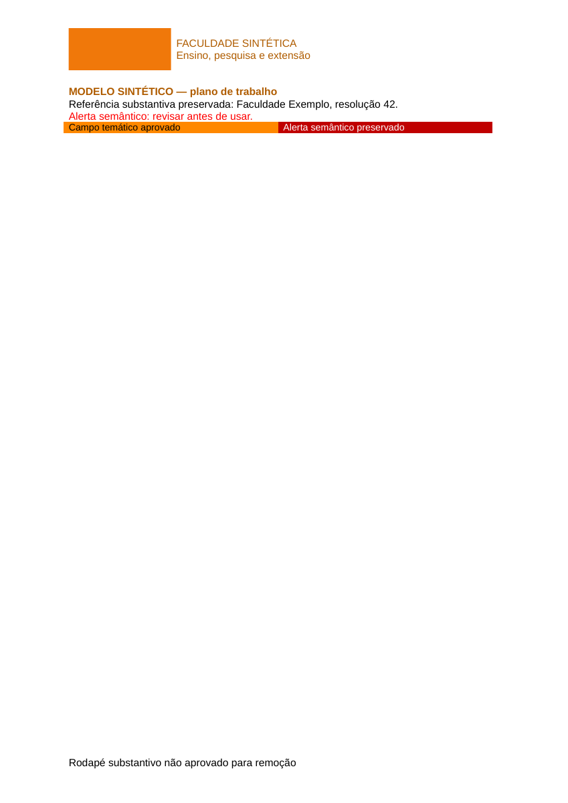
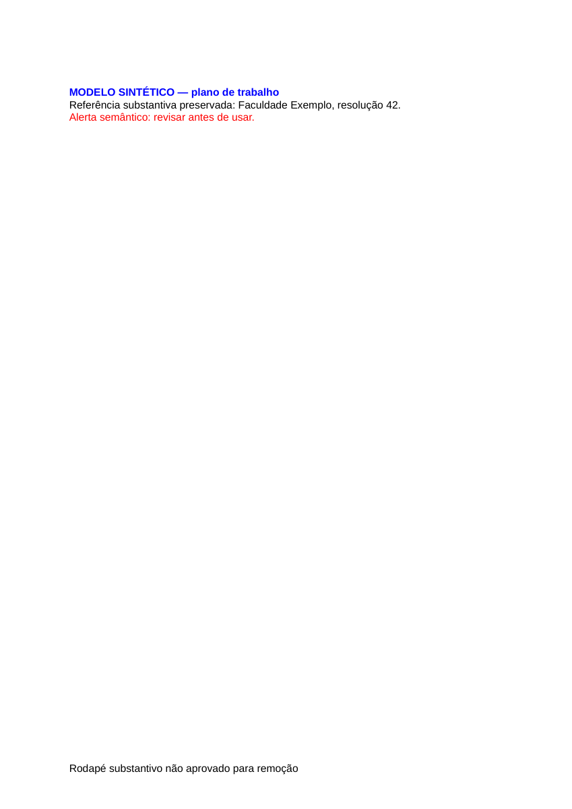
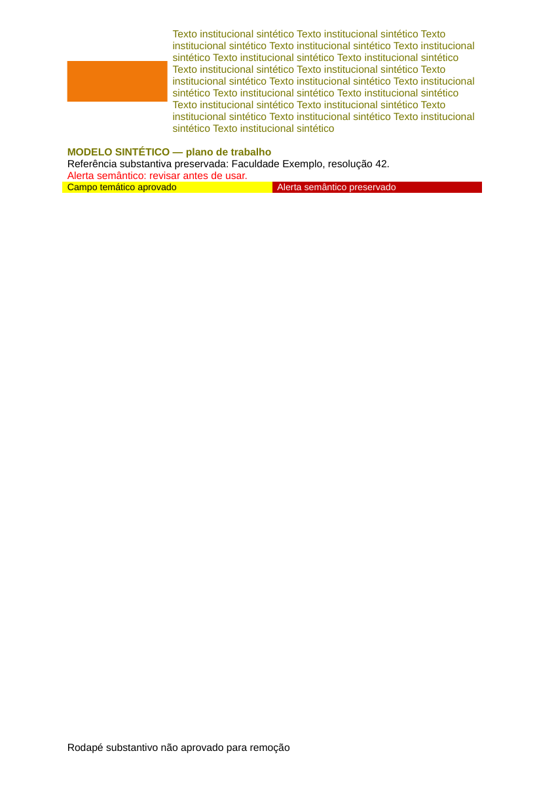

# Identidade institucional — entrega para revisão

Base: `79f42f112350a5375ff3b66e6e556fcfe264ac13`, main revalidada em 03/11/2026.
Branch: `feature/institution-template-branding-cloud`.
Reconstrução a partir do remoto, sem arquivos do desktop e sem acesso a documentos/credenciais de produção.

## Comportamento

- `document_branding` nullable, com `header_text` até 600 caracteres, `theme_color` HEX/null e `logo_data` PNG 300×120/null. Entrada PNG/JPEG até 2 MB; SVG recusado. A imagem é decodificada e normalizada no navegador com proporção preservada, sem metadados da origem.
- Editor independente para IES existentes. Gestor/master com MFA podem editar; equipe/leitor vinculados consultam sob as regras RLS existentes (inclusive MFA). Sugestão de cor é opt-in. HEX e seletor continuam editáveis. O texto temático é ajustado para contraste 4,5:1 sobre branco; preenchimentos de estilos explicitamente aprovados usam texto preto/branco contrastante.
- Prévia de cabeçalho com 25% logo/75% texto; não representa paginação. IES é chave do componente; cargas, imagens, saves e downloads obsoletos são descartados. O RPC exige `expected_updated_at`, comparado atomicamente. Um trigger mantém versão estritamente crescente.
- A biblioteca envia bytes em memória após autorização por sessão/RLS, verificação SHA-256 e auditoria. DOCX sem preparação, PDF e XLSX são devolvidos byte a byte originais. O cliente ainda entende a resposta antiga de URL assinada para compatibilidade de implantação.
- DOCX preparado exige caminho separado `<institution_id>/templates/<template_sha256>.docx`, hash do template, hash da fonte igual ao cadastro e referência editorial. A fonte atual também é baixada e verificada antes da personalização. Falha de hash/revisão/auditoria impede a entrega. Nenhuma cópia personalizada é salva no Storage.
- Cor somente nos estilos enumerados; cores semânticas, formatação direta, corpo, fontes, gráficos, imagens e rodapés não aprovados permanecem preservados. Todas as cópias partem do template imutável, evitando cabeçalhos acumulados.

## Alcance exato das cores

| Elemento | Suporte neste patch |
| --- | --- |
| Texto do cabeçalho gerado | Cor institucional ajustada para contraste sobre branco |
| Faixa/fundo do cabeçalho | Não é criada nem colorida automaticamente |
| Estilo de parágrafo/caractere listado | Cor de texto e sombreamentos `w:shd` daquele estilo |
| Estilo de tabela listado | Preenchimento de célula definido no estilo (`w:tcPr/w:shd`) e cor de texto herdada, sem alterar o corpo |
| Preenchimento direto de célula/trecho no corpo | Preservado; não há seletor de células nem substituição global |
| Alerta/estilo não marcado | Preservado |

A fixture inclui uma tabela `InstitutionTable` aprovada com uma célula temática e outra célula com alerta vermelho direto não marcado. Os testes confirmam corpo byte a byte e cor vermelha intactos; a renderização confirma célula temática laranja/amarela, conforme HEX, ao lado do alerta vermelho. A variante sem cor conserva o preenchimento azul original do estilo. Na revisão, migrar editorialmente campos que precisem de tema para estilos apropriados; este mecanismo não promete colorir toda formatação direta existente. A ordenação XML de `w:rPr` foi validada antes de `w:tcPr`/propriedades de tabela.

## Segurança e integração pendentes

**Não aplicar nem publicar automaticamente.** `supabase/review/institution_document_branding.sql` é SQL de revisão, intencionalmente fora de `migrations/`. Após a revisão e conciliação, gerar a migração pela CLI, revisar os grants e aplicar na ordem coordenada: banco, função, frontend. Não houve deploy, merge, alteração de dados reais, habilitação de arquivo ou política de Storage nova.

O RPC público é SECURITY INVOKER e chama uma função privada SECURITY DEFINER com UID/MFA/papel explícitos, search_path vazio e controle de versão. O SQL calcula os ACLs atuais durante a execução. Converte apenas um grant direto de UPDATE da tabela em grants das colunas que já eram editáveis, preservando opções de concessão; grants que já são por coluna ficam intactos. Não restaura acesso removido por outra frente nem usa lista histórica de colunas. Acesso herdado/PUBLIC que ainda permita UPDATE de `document_branding` provoca erro e rollback, exigindo conciliação explícita. INSERT de IES permanece sujeito à política master existente. A auditoria não armazena logo/texto.

O banco valida estrutura JSON, tamanho, assinatura/dimensões/chunks/CRC PNG e IHDR limitado a RGB/RGBA de 8 bits, compressão/filtro padrão e sem interlace; a decodificação integral do fluxo PNG e sua regravação sem metadados ocorrem no download, antes da entrega. Um PNG malformado forjado diretamente no RPC que passe as verificações estruturais falha fechado no decodificador. Não afirmar que PostgreSQL faz decodificação raster completa.

`NewInstitutionForm` pertence **somente ao cadastro legado**. A frente IES usa rascunho privado por `vertice_ies_register(name, emec, source_reference)` e aprovação por `vertice_ies_review_registration(uuid, approve)`. Se essa jornada estiver ativa, preservar suas RPCs: não usar `saveRow` direto nem adicionar branding ao rascunho. Após aprovação, o editor independente atende a IES criada. Não foram implementadas/ativadas flags de IES, Masters, convites ou e-MEC.

Pontos de conciliação:

- `OwnerDashboard.tsx`: troca pequena do formulário legado; a seleção da jornada nova pertence ao integrador.
- `Workspace.tsx`: import + editor independente, sem alterar cadastro regulatório.
- `RecordForm.tsx`: `children?: ReactNode`, `submitDisabled?: boolean` e guarda de submissão.
- `source-overrides/package.json`/lock: apenas `jsdom@26.1.0` como devDependency para testes de troca de IES; nenhuma versão de dependência anterior mudou. Reconciliar com as outras frentes, sem substituir seu lockfile cegamente. Sem alteração em vitest.config.ts.
- `InepLibrary.tsx`/Edge Function: contrato adicional de resposta binária; usar ambos na integração.

Limites: testes Auth/Storage HTTP usam clientes sintéticos; PostgreSQL real descartável executou as funções/políticas com helpers de claims compatíveis. Não houve login real nem teste ponta a ponta contra o Supabase hospedado. A renderização foi validada em LibreOffice 7.4 com fixtures; arquivos reais e outros editores ainda exigem revisão editorial/visual individual. Os 420 registros e placeholders não foram classificados como templates por este patch.

## Preparação offline

`scripts/branding/prepare-template.ts` não acessa Supabase. O manifesto exige:

```json
{
  "classification": "reviewed-template",
  "source_sha256": "<sha256 exato do mestre original>",
  "review_ref": "<referência da revisão editorial>",
  "replace_headers": ["word/header1.xml"],
  "clear_footers": [],
  "theme_style_ids": ["InstitutionAccent"],
  "preserved_parts_review": {"docProps/core.xml": "<sha256 do part revisado>"},
  "remove_parts": []
}
```

`preserved_parts_review` precisa enumerar por hash todos os docProps, mídias e embeddings da fonte, inclusive itens cuja remoção foi explicitamente aprovada. É uma declaração editorial, não um detector de marcas. Opcional `remove_parts` foi acrescentado para remover somente metadados ou mídias órfãs aprovados; uma mídia ainda referenciada pelo documento é recusada. Não há substituição de nomes no corpo. Rodapés só são esvaziados se listados. Documentos com conteúdo ativo, assinatura digital ou recursos externos não suportados são recusados.

Os cabeçalhos listados precisam já existir e ter referências no documento. Templates sem esse espaço devem passar por preparação editorial adicional, evitando reescrever o corpo automaticamente. Revisar conteúdo institucional substantivo, direitos, mídia antiga, primeiras páginas/cabeçalhos pares e ímpares e metadados antes de liberar qualquer cópia.

```sh
DENO_DIR=/tmp/vertice-deno-cache deno run \
  --allow-read=/caminho/entrada --allow-write=/caminho/saida-nova \
  scripts/branding/prepare-template.ts \
  /caminho/entrada/fonte.docx /caminho/entrada/revisao.json /caminho/saida-nova
```

A pasta de saída deve ser nova. A ferramenta cria `<hash>.docx` e `review.json` exclusivamente, sem sobrescrita. Repetir na mesma pasta falha com `AlreadyExists`; isso foi testado. O resultado é **preparado, não publicado**. Upload e associação no catálogo dependem da revisão posterior; nenhum comando deste pacote faz isso.

## Reprodução e resultados

Ferramentas usadas: Node 24, Deno 2.9.6; dependências npm do processamento fixadas no código e no `supabase/functions/vertice-inep-library/deno.lock`. Fonte reconstruída em diretório separado:

```sh
unzip -q vertice-servidor-source.zip -d /tmp/vertice-check
cp -a source-overrides/. /tmp/vertice-check/
cp -a supabase /tmp/vertice-check/
cd /tmp/vertice-check
npm ci --legacy-peer-deps --cache /tmp/vertice-npm-cache
npm run check
npm test
npm run build:static
```

Resultados finais: TypeScript aprovado; **149 testes / 25 arquivos aprovados**; build estático aprovado (aviso já existente de chunks >500 kB). O build não foi publicado e os ZIPs de distribuição existentes não foram substituídos.

```sh
deno check --lock=supabase/functions/vertice-inep-library/deno.lock supabase/functions/vertice-inep-library/index.ts
deno test --lock=supabase/functions/vertice-inep-library/deno.lock scripts/branding/document-template.test.ts
```

Deno: **9 testes de cenários aprovados**, incluindo manifesto/hash, preservação de bytes, estilos/fills explícitos, mídia referenciada, XML/ZIP não seguros, PNG inválido, ausência de logo, repetição, permissões negativas e auditoria. Nenhum acesso de rede/Storage real nesses testes.

PostgreSQL 17 descartável em Docker, com `scripts/branding/bootstrap-test-db.sql`, migrações existentes `202610260001_access_foundation`, `202610300001_area_real`, `20261101224102_institutional_inep_library` e SQL de revisão:

- `supabase/tests/institution_document_branding.sql`: aprovado; RLS, MFA, papéis, CAS, bloqueio da escrita direta, validação, auditoria, nenhum template habilitado e restrições de revisão.
- `supabase/tests/institution_logo.sql`: aprovado; PNG sintético válido, CRC corrompido e dimensões inválidas.
- `supabase/tests/inep_library.sql`: aprovado; tenant/inativos/MFA/externo/anon/Storage/escrita no catálogo.
- `python3 scripts/branding/test-concurrency.py`: dois escritores simultâneos com a mesma versão; exatamente um grava, o outro recebe conflito. Script aponta exclusivamente ao container descartável `vertice-branding-postgres`.

Fixtures visuais geradas por `scripts/branding/render-fixtures.ts`; convertidas em PDF pelo LibreOffice headless e rasterizadas pelo `pdftoppm`. Inspeção visual confirmou cabeçalho, texto longo, ausência de logo, célula temática colorida ao lado de alerta vermelho preservado e rodapé substantivo preservado. Não representam validação de todos os arquivos reais.





A leitura do changelog Supabase foi tentada mas recebeu 403; a documentação oficial de RLS foi consultada: https://supabase.com/docs/guides/database/postgres/row-level-security. A CLI local não ficou utilizável (v3 tentou escrever em diretório de configuração somente leitura; instalação v2 falhou no download DNS). Isso não foi contornado com credenciais ou acesso remoto; o SQL ficou como artefato de revisão, testado diretamente no PostgreSQL descartável.

## Correções após revisão independente — campos Word e PNG

A reprodução negativa de INCLUDEPICTURE falhava no commit anterior ("Missing expected rejection"); está registrada em `branding-validation/vertice-fields-before.log`. A validação agora percorre **todos os XML parts**, tanto ao preparar a fonte quanto ao abrir o template revisado no download. Analisa `fldSimple` e reconstrói instruções complexas pela sequência begin/instrText/separate/end, concatenando runs antes de validar. Variações de caixa e espaços não contornam a regra.

A lista permitida é restrita a **PAGE, NUMPAGES, SECTION e SECTIONPAGES**, com switches de formato `\* Arabic`, `Roman`, `Alphabetic`, `MERGEFORMAT` e `CHARFORMAT` (caixa indiferente). São rejeitados todos os demais comandos, campos aninhados, instruções órfãs/deletadas, dados de formulário, marcadores malformados e campos sem fechamento. Isso inclui DDE/DDEAUTO/INCLUDETEXT/INCLUDEPICTURE sem relacionamento externo. A regra é intencionalmente conservadora: DATE, REF, IF, TOC etc. também exigem futura análise explícita; não são removidos nem convertidos silenciosamente. Campos passivos aceitos no corpo/rodapé são preservados byte a byte.

PNG: antes de `PNG.sync.read`, a Edge rejeita bit depth diferente de 8, color type diferente de RGB/RGBA (2/6), compressão/filtro não padrão e interlace diferente de zero. O SQL aplica o mesmo perfil IHDR. Isso impede entrada no caminho Adam7 de pngjs 7 que infla sem limite. A fixture usa 200 KB de dados comprimidos controlados, dimensões 300×120 e CRCs válidos; o teste substitui o decoder por um observador e confirma **zero chamadas** para interlace e demais codificações recusadas. RGB/RGBA normalizados seguem aceitos. Nenhum payload foi enviado ao Supabase.

`python3 scripts/branding/test-review-acls.py` executa seis bancos novos descartáveis: grant amplo, amplo com grant option de coluna, amplo com grant option de tabela, somente colunas restritas, nenhum UPDATE e UPDATE herdado de PUBLIC. Compara permissões e opções de concessão antes/depois; a última variante exige rollback. A variante ampla também repete os testes SQL de identidade, logo e biblioteca. Todos aprovados.

Após as correções: Deno check, 8 conjuntos Deno, TypeScript, 149 testes da aplicação e build estático passaram novamente. O rollout continua **banco revisado → Edge → frontend**; não publicar frontend/Edge antecipadamente sem uma feature flag coordenada. PR continua bloqueado pela negativa anterior; nenhuma nova tentativa, merge ou deploy foi feita. A revisão independente final ainda é necessária antes de habilitar modelos reais.

## Conciliação live e reteste de conteúdo ativo — 03/11/2026

Leitura do Supabase confirmou projeto Vértice `qvetbbmviatxxatzzuzc` ACTIVE_HEALTHY, Edge `vertice-inep-library` ainda v3, sem colunas de branding/template. A migração `20261103133845_ies_onboarding_disabled_reviewed` já está no banco; as políticas de instituições/biblioteca e funções de papel/MFA permanecem compatíveis com a base testada. Nenhum dado ou arquivo real foi alterado por esta inspeção. O Render expôs dois workspaces e aguarda confirmação do workspace correto; não houve seleção presumida nem deploy.

A nova regressão de tipos ativos falhava antes desta correção (`vertice-renamed-before.log`). A validação agora exige o ContentType principal DOCX não macroEnabled, recusa ContentTypes de VBA/ActiveX/OLE/macros independentemente do nome, bloqueia relações ativas (inclusive vbaProject/control/activeXControlBinary/package) e inspeciona XML declarado por Default/Override mesmo quando renomeado `.dat`. Payloads usam somente bytes sintéticos inertes, sem macro real. Testes negativos cobrem preparação e personalização. Pacotes embutidos e tipos ativos não suportados são recusados por inteiro; não são apagados silenciosamente.

Compatibilidade do rollout: o cliente novo envia `responseVersion: 2` para receber bytes. A Edge nova mantém JSON/URL assinada para clientes antigos ao baixar originais, após hash/auditoria. Um modelo preparado exige o cliente novo e retorna pedido de atualização ao antigo. Assim a ordem banco → Edge → frontend não interrompe os downloads antigos enquanto a interface atualiza. Nenhum modelo será ativado automaticamente. Reteste independente do próximo commit é pré-requisito para publicação.
